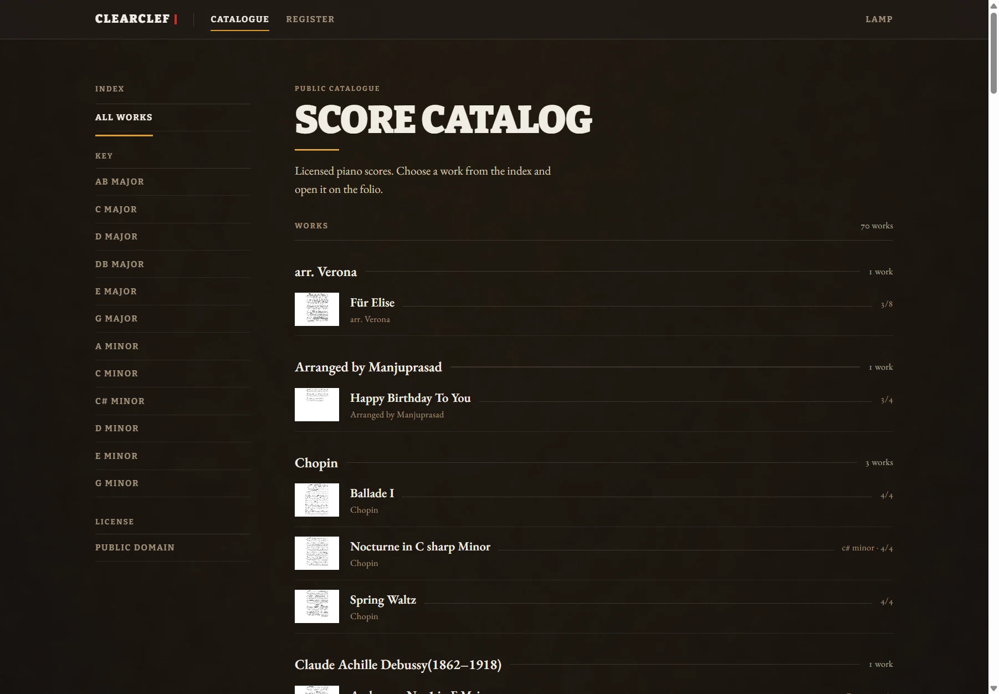
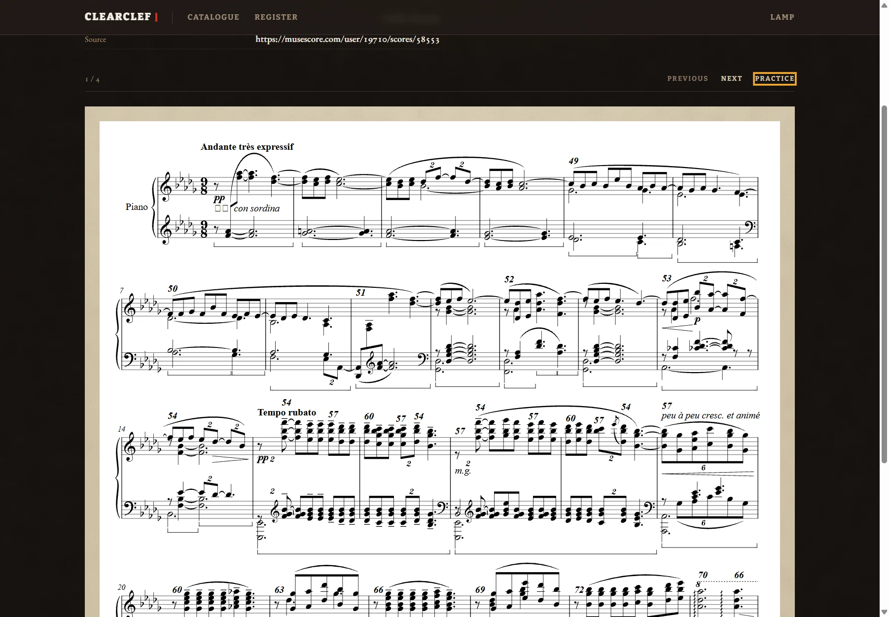
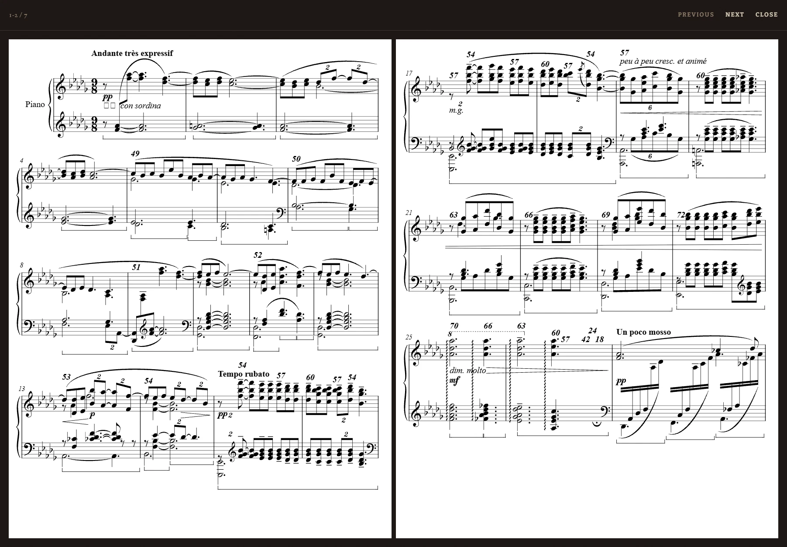
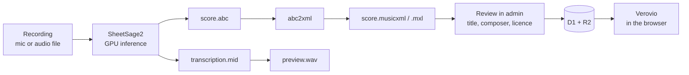
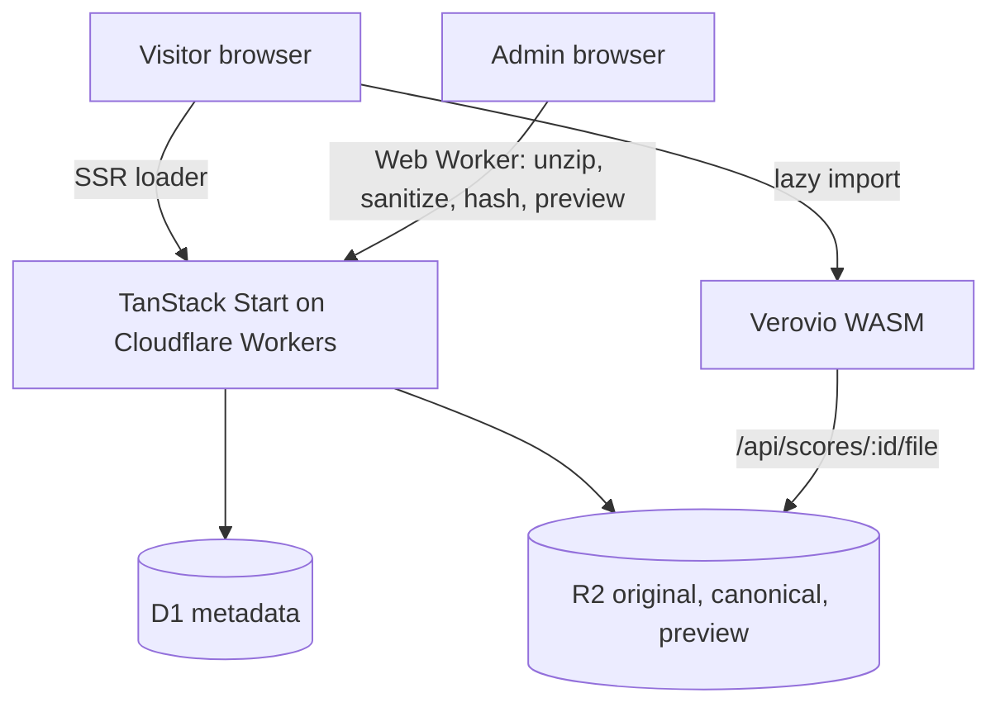

# ClearClef

**A piano practice library, engraved in the browser.**

ClearClef is the score library I use to learn piano: 70+ licensed works, filtered by key, difficulty and tag, engraved from MusicXML with Verovio and readable full-screen at the keyboard. A separate local GPU lab turns a recording into MusicXML, so a piece I can play or hum can become a score I can practise from.

[Live catalogue](https://clearclef.dedog.top) · [Architecture](docs/architecture.md) · [Ingest and security](docs/ingest.md) · [AI transcription lab](tools/sheetsage2-lab/README.md)

---

## Why this exists

I wanted one place where a piece is a **record**, not a file: composer, key, difficulty, licence, and a score that opens at the piano. A folder of PDFs and bookmarks cannot answer "what can I play in A minor tonight?" — and a scanned or recorded piece usually arrives without any of that metadata. So the catalogue carries the metadata, the browser carries the engraving, and a small local model pipeline carries the pieces that only exist as audio.

## What's inside

| | |
| --- | --- |
| **Catalogue** | Credit-grouped contents list, page-1 engraving previews, and one-value-at-a-time filters for key, difficulty, licence and tag. |
| **Reader** | Page-by-page SVG from MusicXML, streamed from R2 and rendered client-side with Verovio. Nothing is engraved on the server. |
| **Practice mode** | Full-screen overlay with single-page or two-page spread layout, keyboard and swipe page turns, auto-hiding chrome, screen wake lock, and position restored across reflow. |
| **Curator** | Protected admin: single upload or a whole folder, duplicate detection, editable metadata, original download, delete, and a private-to-public publish step. |
| **AI transcription** | A local GPU lab that transcribes full-length piano audio to ABC, MIDI and MusicXML, with a batch queue and an audio preview, ready for review and upload. |

## Screens



*Catalogue: credit-grouped contents list with key, licence and tag filters, and a page-1 engraving preview per work.*



*Reader: paginated Verovio engraving on the folio, with page controls and a one-click practice entry.*



*Practice mode: two-page spread, page count, and quiet chrome that stays out of the notation.*

---

## AI: from a recording to a readable score

SheetSage2 is a joint transcription model: given audio, it predicts notes, onsets and score structure. The lab wraps it in a queue, converts its ABC output to MusicXML, and packages an `.mxl` that the catalogue can ingest.



What the lab actually handles:

- **Full-length audio**, not fixed clips: SheetSage2 runs overlapping windows, so a whole performance is transcribed. That means longer runs and more VRAM, and the UI says so.
- **A real queue**: multiple files, microphone capture, one job on the GPU at a time, per-row failures that do not stop the batch, and a cancel that finishes the file already on the GPU.
- **Artifacts on disk**: `score.abc`, `transcription.mid`, `events.json`, `score.musicxml`, `score.mxl`, and a synthesized `preview.wav` for quick listening.
- **Review before publishing**: the model output is a draft. Titles, credits and licences are corrected in the admin UI before the score becomes public.

| Stage | Runs on | Why |
| --- | --- | --- |
| Capture | Local | Audio stays on my machine. |
| Inference | Local GPU (WSL2 + CUDA) | Long audio, one job at a time, no request timeout. |
| ABC → MusicXML | Local | `abc2xml`, then MXL packaging. |
| Review | Admin UI | Human correction is part of the workflow. |
| Engraving | Browser | Verovio WASM, lazy-loaded. |

The model is [m-a-p/SheetSage2](https://huggingface.co/m-a-p/SheetSage2), released under **CC BY-NC 4.0**. Weights are not distributed here; the lab is an integration and evaluation harness around the authors' work.

---

## Architecture



| Layer | Choice |
| --- | --- |
| App | TanStack Start + TanStack Router + TypeScript |
| UI | Tailwind + shadcn/ui, custom archive design system |
| Data | Cloudflare D1 + Drizzle ORM |
| Files | Cloudflare R2: originals, canonical MusicXML, page-1 previews |
| Auth | Better Auth on D1, email/password, admin role, no public sign-up |
| Engraving | Verovio WASM, client-only |
| Deploy | `cf build` + `cf deploy --prebuilt` |
| Tests | Vitest, 27 suites |

## Three constraints that shaped the build

**1. Workers Free gives 10 ms of CPU per request.**
A 2.36 MB MusicXML file took ~127 ms to parse and preflight started returning `exceededCpu` 503s. So the browser does the reading: a Web Worker unzips, sanitizes, extracts metadata and hashes each file during review, then sends one small JSON lookup for duplicates. The server's upload path only re-sanitizes the canonical text, re-hashes it and writes objects. Batch review is now bounded by the browser, not the Worker budget.

**2. Uploads are hostile XML.**
MusicXML is XML, so the ingest path treats every file as untrusted: strip `DOCTYPE`, reject `<!ENTITY>` and internal subsets before parsing, apply declared size and file-count limits before decompression, reject zip-slip paths, extract only the container and rootfile, decode from BOM or declaration, and parse metadata from the header and first measure only with entity processing off. The canonical document is re-sanitized and re-hashed on the server even when the browser prepared it.

**3. Engraving is heavy; the catalogue must stay light.**
No Verovio or WASM is imported on catalogue routes. The viewer is a `React.lazy` boundary, SVGs are paginated rather than accumulated, and the page-1 preview is rendered once at ingest and stored in R2. Catalogue HTML is cached at the edge and purged by slug when an admin publishes or edits.

## Design

The visual system is an archive reading room rather than a dashboard: near-black ground, a paper folio that only ever holds notation, and brass reserved for the current item. Bitter for capitals, EB Garamond for sentence case, Geist Mono for identifiers. Both themes are dark; the score paper never changes, because notation is ink on white paper.

Accessibility is part of the same system: semantic landmarks, visible focus, `aria-live` page announcements, reduced-motion support, and larger coarse-pointer targets.

## Repository map

```text
src/routes/           public catalogue, admin, API handlers
src/server/           createServerFn data access (D1 stays off the client)
lib/ingest/           XXE-hardened readers, canonical XML, browser worker
lib/viewer/           Verovio layout, spreads, position, SVG sanitizing
components/           catalogue, score, admin UI
drizzle/              D1 schema and migrations
tools/sheetsage2-lab/ audio → MusicXML GPU lab
docs/                 architecture, ingest, rendering, ADRs
tests/                Vitest suites
AGENTS.md             guardrails for coding agents working in the repo
```

## Run it locally

Requires Node 24, pnpm 11 and a logged-in Cloudflare CLI session (`pnpm exec cf auth login`).

```bash
corepack enable
cp .dev.vars.example .dev.vars
pnpm install
pnpm db:migrate:local
pnpm dev
```

Open `/admin/setup` on first run to create the admin account. Then:

- `pnpm test` — Vitest
- `pnpm typecheck` — TypeScript
- `pnpm lint` — ESLint

More detail in [docs/local-dev.md](docs/local-dev.md) and [docs/cloudflare.md](docs/cloudflare.md).

## Status and limits

- The public catalogue, reader, practice mode, admin curator and batch ingest are built.
- Writes are admin-only by design; there is no public sign-up.
- No in-browser note editing, transposition or MIDI playback yet.
- The transcription lab runs locally and is not part of the deployed app. Its output is reviewed before it enters the catalogue.
- Score files, model weights and run outputs are not committed to this repository.

## Credits and licence

- [Verovio](https://www.verovio.org/) (LGPL-3.0) engraves the scores in the browser.
- [SheetSage2](https://huggingface.co/m-a-p/SheetSage2) by m-a-p (CC BY-NC 4.0) powers the transcription lab. Weights are not included.
- [abc2xml](https://wim.vree.org/svgParse/abc2xml.html) by Willem G. Vree (LGPL) is vendored for ABC → MusicXML and keeps its own licence.
- Typefaces: Bitter, EB Garamond and Geist Mono (SIL OFL).

Application code is MIT licensed — see [LICENSE](LICENSE). Every score record carries its own licence; score files are not distributed in this repository.
