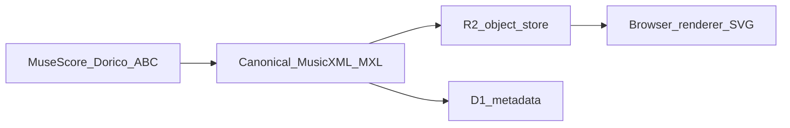
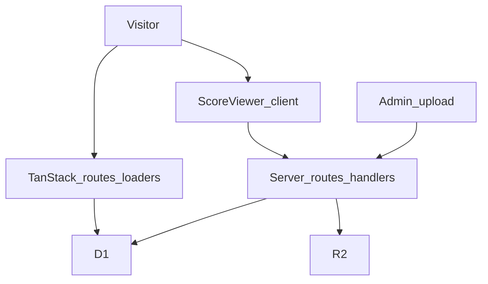

# Architecture

ClearClef is a [TanStack Start](https://tanstack.com/start) app on Cloudflare Workers (`cf build` + `cf deploy --prebuilt`). Public catalog HTML is SSR’d from route loaders backed by D1; score engraving runs only in the browser.

## Stack

| Concern | Technology | Notes |
| --- | --- | --- |
| Package manager | pnpm 11 (Corepack; `packageManager` in `package.json`) | Do not use npm or yarn |
| App | TanStack Start + TanStack Router + TypeScript | Routes under `src/routes/`; `src/router.tsx` + generated `routeTree.gen.ts` |
| Deploy | `cf build` + `cf deploy --prebuilt` | Output under `.cloudflare/output/`. Config: `cloudflare.config.ts` + `worker-bindings.mjs`. See [cloudflare.md](cloudflare.md). |
| Local dev | `pnpm dev` (`cf dev`, port 3000) | `development` mode; bindings via `cloudflare:workers`; persist `.cloudflare/state` |
| UI | Tailwind (`@tailwindcss/vite`) + shadcn/ui | Global styles in `src/styles/globals.css` |
| Score objects | Cloudflare **R2** (`clear-clef`, binding `SCORES_BUCKET`) | Zero egress; immutable object caching |
| Metadata | Cloudflare **D1** + Drizzle ORM | SQLite at the edge (`DB`) |
| Server data | `createServerFn` in `src/server/*` | Keeps `cloudflare:workers` / D1 off the client bundle |
| Optional later | KV cache tags, Turnstile on upload, OAuth providers | Do not block MVP |

## Data flow (canonical score)

## Request flows (MVP)

### Public browse (cacheable)

1. The catalog loader calls `searchPublicCatalog()` through `createServerFn` (`src/server/public.ts`).
2. Default browse is 30 works per page, grouped by composer; `?q=` uses FTS5 relevance; facets and sort are URL state.
3. Filtered and search pages are `noindex,follow` and are not stored in the Workers Cache API. Default browse and score pages are cached for 60s and purged on admin writes.
4. Page-1 previews and score files are served from versioned URLs; only a matching `v` token gets `immutable`.
5. They **must not** import Verovio or any WASM.

### Score viewer (client-only)

1. Detail route mounts `ScoreViewerLoader` (`React.lazy` + `Suspense`).
2. The client fetches `.mxl` / MusicXML from `/api/scores/{id}/file` (streams from R2).
3. Verovio loads the buffer and renders SVG **per page**; v1 uses Previous/Next pagination (not scroll lazy-load).
4. Engraved SVGs are huge DOMs — never SSR them.

### Admin catalog writes (not public)

1. First boot: create the admin at `/admin/setup` (one-time; public sign-up remains disabled).
2. Protected `/admin` (overview), `/admin/upload`, `/admin/batch-upload`, `/admin/scores`, `/admin/scores/{id}` (Better Auth admin session; layout loader in `admin/_protected`).
3. Create: API handler validates, sanitizes the canonical MusicXML, writes R2 objects, inserts D1 rows. Batch upload inspects files in a browser Web Worker (unzip, metadata, hash), sends one JSON catalog lookup, then creates one score per request with an `upload_key` and `import_id`; the browser orchestrates two at a time. The upload includes the original file and canonical XML so the Worker does not unzip or full-parse a score.
4. Update: `PATCH` metadata and optional file replace (the browser also prepares canonical XML); delete: D1 row + R2 prefix; download original via admin-only file route.
5. Page-1 preview SVG is generated at ingest or file replace in the admin browser, not on every catalog request. Batch previews use one Verovio worker; failures are per-row and retryable.
6. Batch publish moves that import's private scores to public and purges their HTML pages.

The browser-first ingest path exists because Workers Free has a **10 ms CPU limit**. Full XML parsing and hashing in the Worker was the source of `exceededCpu` 503s during batch review. Worker routes now only perform duplicate lookups, sanitize/hash canonical text, and store objects.

## Cloudflare bindings (conceptual)

Declared in `cloudflare.config.ts`:

- `DB` — D1 database for catalog metadata and Better Auth tables
- `SCORES_BUCKET` — R2 `clear-clef` (originals, canonical MusicXML, previews under `scores/`)
- `BETTER_AUTH_SECRET` — Better Auth signing secret (`bindings.secret()`; `.dev.vars` locally, `cf` in deploy)
- `BETTER_AUTH_URL` — public origin for auth + cache purge (`bindings.text()` in `cloudflare.config.ts` per `mode`; `development` = localhost, not `.dev.vars`)

Access in server code: `import { env } from "cloudflare:workers"`.

## Caching

| Asset | Policy |
| --- | --- |
| R2 score / preview / thumb objects | `Cache-Control: public, max-age=31536000, immutable` **only on versioned URLs** (`?v=…`); unversioned or stale URLs redirect to the current token |
| Catalog HTML (`/`, `/scores/{slug}`) | Workers Cache API (`src/start.ts`): match before render, store for 60s, `purgePublicScore(slug)` after admin writes. Default browse only; filtered/search pages are `no-cache`. |
| Filtered / search catalog | Dynamic; `Cache-Control: public, max-age=0, must-revalidate`, `noindex,follow` |
| Sitemap / robots | Generated from D1; one-hour cache; yielded to Cloudflare's managed robots configuration when present |
| Vite client assets | Immutable hashed filenames (`.cloudflare/output/` after `cf build`) |

Public media version tokens come from `contentHash` (score files) and `previewVersion` (regenerated previews). Replacing a file therefore changes the URL and cannot leave a year-long stale cache entry.

## Related docs

- [data-model.md](data-model.md) — tables and object keys
- [ingest.md](ingest.md) — upload pipeline
- [rendering.md](rendering.md) — Verovio details
- [roadmap.md](roadmap.md) — implementation order
