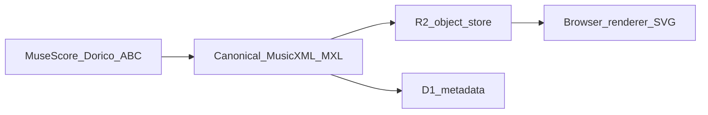
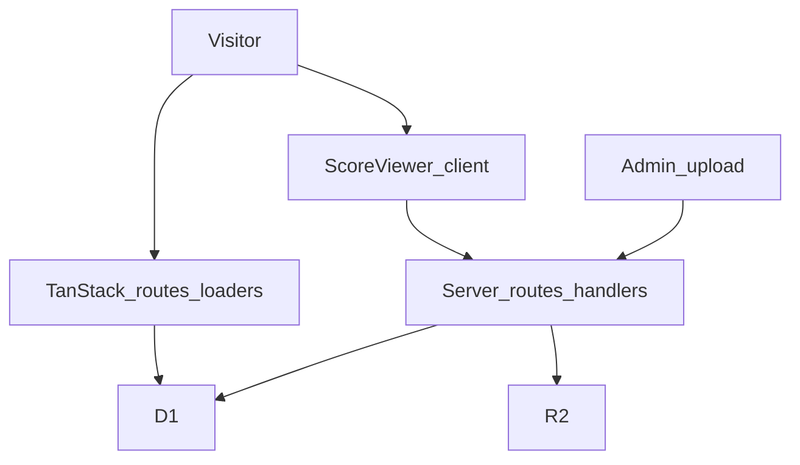

# Architecture

ClearClef is a [TanStack Start](https://tanstack.com/start) app on Cloudflare Workers (`cf build` + `cf deploy --prebuilt`). Public catalog HTML is SSR’d from route loaders backed by D1; score engraving runs only in the browser.

## Stack

| Concern | Technology | Notes |
| --- | --- | --- |
| Package manager | pnpm 11 (Corepack; `packageManager` in `package.json`) | Do not use npm or yarn |
| App | TanStack Start + TanStack Router + TypeScript | Routes under `src/routes/`; `src/router.tsx` + generated `routeTree.gen.ts` |
| Deploy | `cf build` + `cf deploy --prebuilt` | Output under `.cloudflare/output/`. Config: `cloudflare.config.ts` + `worker-bindings.mjs`. See [cloudflare.md](cloudflare.md). |
| Local dev | `pnpm dev` (`cf dev`, port 3000) | `development` mode; bindings via `cloudflare:workers`; persist `.cloudflare/state` |
| UI | Tailwind (`@tailwindcss/vite`) + shadcn/ui | Global styles in `src/styles/globals.css` |
| Score objects | Cloudflare **R2** (`clear-clef`, binding `SCORES_BUCKET`) | Zero egress; immutable object caching |
| Metadata | Cloudflare **D1** + Drizzle ORM | SQLite at the edge (`DB`) |
| Server data | `createServerFn` in `src/server/*` | Keeps `cloudflare:workers` / D1 off the client bundle |
| Optional later | KV cache tags, Turnstile on upload, OAuth providers | Do not block MVP |

## Data flow (canonical score)

## Request flows (MVP)

### Public browse (cacheable)

1. List and detail routes use **loaders** that call `createServerFn` helpers (`src/server/public.ts`).
2. They query D1 for metadata (`visibility = 'public'`).
3. They render HTML title, composer, license, tags, and a static page-1 preview when available (`head` on score routes).
4. They **must not** import Verovio or any WASM.

### Score viewer (client-only)

1. Detail route mounts `ScoreViewerLoader` (`React.lazy` + `Suspense`).
2. The client fetches `.mxl` / MusicXML from `/api/scores/{id}/file` (streams from R2).
3. Verovio loads the buffer and renders SVG **per page**; v1 uses Previous/Next pagination (not scroll lazy-load).
4. Engraved SVGs are huge DOMs — never SSR them.

### Admin catalog writes (not public)

1. First boot: create the admin at `/admin/setup` (one-time; public sign-up remains disabled).
2. Protected `/admin` (overview), `/admin/upload`, `/admin/scores`, `/admin/scores/{id}` (Better Auth admin session; layout loader in `admin/_protected`).
3. Create: API handler validates, extracts metadata, writes R2 objects, inserts D1 rows.
4. Update: `PATCH` metadata and optional file replace; delete: D1 row + R2 prefix; download original via admin-only file route.
5. Page-1 preview SVG is generated at ingest or file replace in the admin browser, not on every catalog request.

## Cloudflare bindings (conceptual)

Declared in `cloudflare.config.ts`:

- `DB` — D1 database for catalog metadata and Better Auth tables
- `SCORES_BUCKET` — R2 `clear-clef` (originals, canonical MusicXML, previews under `scores/`)
- `BETTER_AUTH_SECRET` — Better Auth signing secret (`bindings.secret()`; `.dev.vars` locally, `cf` in deploy)
- `BETTER_AUTH_URL` — public origin for auth + cache purge (`bindings.text()` in `cloudflare.config.ts` per `mode`; `development` = localhost, not `.dev.vars`)

Access in server code: `import { env } from "cloudflare:workers"`.

## Caching

| Asset | Policy |
| --- | --- |
| R2 score / preview objects | `Cache-Control: public, max-age=31536000, immutable` (content-addressed or versioned keys) |
| Catalog HTML (`/`, `/scores/{slug}`) | Workers Cache API (`src/start.ts`): match before render, store for 60s, `purgePublicScore(slug)` after admin writes. Keys use the request origin and must match `BETTER_AUTH_URL` for purge to hit. |
| Filtered catalog (`/?key=…`) | Treat as dynamic; do not rely on shared HTML cache for filtered URLs |
| Vite client assets | Immutable hashed filenames (`.cloudflare/output/` after `cf build`) |

## Related docs

- [data-model.md](data-model.md) — tables and object keys
- [ingest.md](ingest.md) — upload pipeline
- [rendering.md](rendering.md) — Verovio details
- [roadmap.md](roadmap.md) — implementation order
