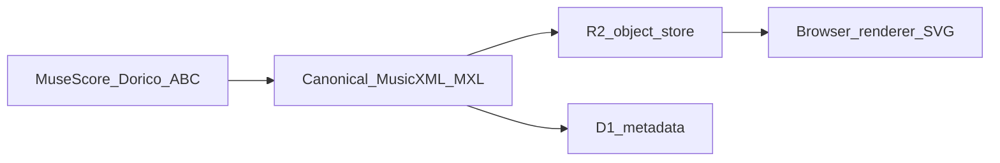
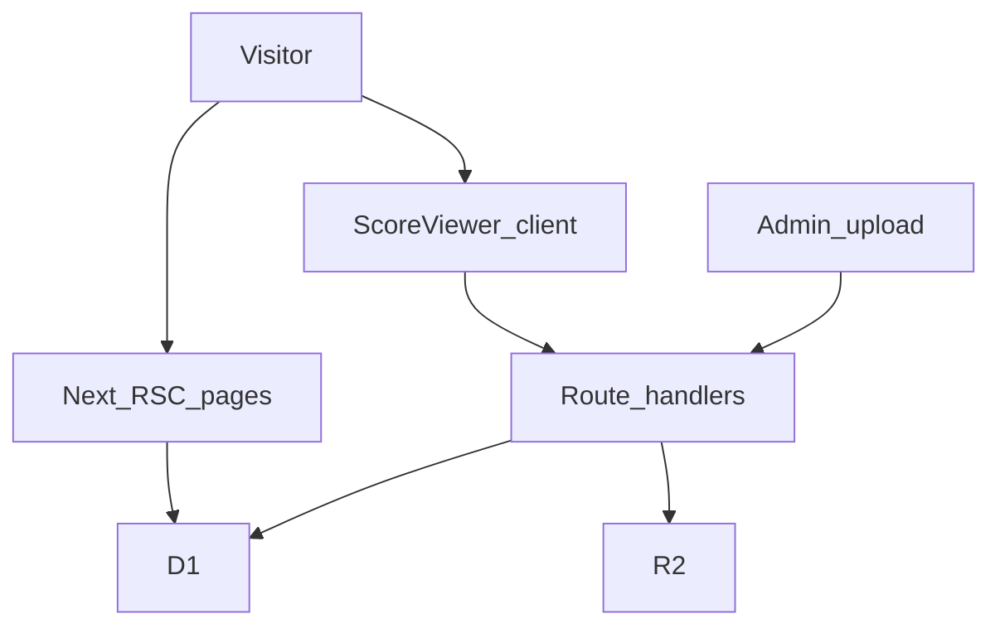

# Architecture

ClearClef is a greenfield Next.js App Router app deployed to Cloudflare Workers via [`@opennextjs/cloudflare`](https://opennext.js.org/cloudflare). Public catalog pages are SEO-friendly Server Components; score engraving runs only in the browser.

## Stack

| Concern | Technology | Notes |
| --- | --- | --- |
| App | Next.js App Router + TypeScript | Node.js runtime only — **do not** set `export const runtime = "edge"` |
| Deploy | OpenNext Cloudflare adapter | `opennextjs-cloudflare` for build / preview / deploy |
| Local bindings | `initOpenNextCloudflareForDev()` in `next.config` | Use `next dev` for day-to-day; `npm run preview` for Workers runtime |
| UI | Tailwind + shadcn/ui | Keep catalog HTML light |
| Score objects | Cloudflare **R2** (scores bucket) | Zero egress; immutable object caching |
| Next ISR / incremental cache | Separate **R2** bucket (OpenNext `NEXT_INC_CACHE_R2_BUCKET`) | Do **not** mix with score files |
| Metadata | Cloudflare **D1** + Drizzle ORM | SQLite at the edge |
| Optional later | KV cache tags, Turnstile on upload, Better Auth / Clerk | Do not block MVP |

## Data flow (canonical score)

## Request flows (MVP)

### Public browse (cacheable)

1. List and detail pages are **Server Components**.
2. They query D1 for metadata (`visibility = 'public'`).
3. They render HTML title, composer, license, tags, and (later) a static page-1 preview URL.
4. They **must not** import Verovio or any WASM.

### Score viewer (client-only)

1. Detail page mounts a Client Component via `next/dynamic(..., { ssr: false })`.
2. The client fetches `.mxl` / MusicXML from an app route that streams from R2.
3. Verovio loads the buffer and renders SVG **per page**; pages lazy-load on scroll.
4. Engraved SVGs are huge DOMs — never SSR them.

### Admin ingest (not public)

1. Protected `/admin/upload` (env secret locally; Cloudflare Access later).
2. Route handler validates, extracts metadata, writes R2 objects, inserts D1 rows.
3. Page-1 preview SVG is generated once at ingest (admin client or one-off Worker), not on every catalog request.

## Cloudflare bindings (conceptual)

When scaffolding, expect roughly:

- `DB` — D1 database for catalog metadata
- `SCORES_BUCKET` — R2 for score originals, canonical MusicXML, previews
- `NEXT_INC_CACHE_R2_BUCKET` — R2 for OpenNext incremental cache only
- `ASSETS` / `WORKER_SELF_REFERENCE` — as required by OpenNext
- `ADMIN_UPLOAD_SECRET` (or Access) — write gate for MVP

Keep score storage and OpenNext cache in **separate** R2 buckets so lifecycle, IAM, and key prefixes stay clear.

## Caching

| Asset | Policy |
| --- | --- |
| R2 score / preview objects | `Cache-Control: public, max-age=31536000, immutable` (content-addressed or versioned keys) |
| Catalog HTML (list/detail) | Short cache or `revalidate` after upload |
| `/_next/static/*` | Immutable (OpenNext `public/_headers`) |

## Related docs

- [data-model.md](data-model.md) — tables and object keys
- [ingest.md](ingest.md) — upload pipeline
- [rendering.md](rendering.md) — Verovio details
- [roadmap.md](roadmap.md) — implementation order
